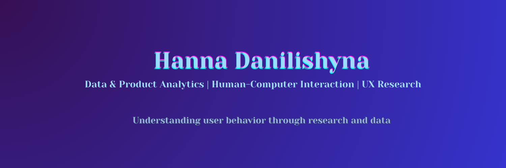

# Hi, I'm Hanna Danilishyna 👋

**Data & Product Analytics | Human-Computer Interaction | UX Research**

I'm an interdisciplinary analyst with professional experience at the intersection of UX Research, Data Analytics, and Product Analytics. I combine user-centered research with quantitative analysis to understand user behavior, identify improvement opportunities, and support data-driven product decisions.

My background in Human-Computer Interaction allows me to approach digital products from both analytical and user experience perspectives.

🌍 Based in Germany  
🔗 GitHub: https://github.com/Hanna-Danilishyna  
🔗 LinkedIn: https://linkedin.com/in/hanna-danilishyna
🔗 Portfolio: https://hanna-danilishyna-portfolio.netlify.app

---

# My Background

My path into analytics started with a deep curiosity about **how people experience technology**.

I hold a **Master’s degree in Human-Computer Interaction from Bauhaus-Universität Weimar**, where I studied how interfaces shape human interaction with complex information systems.

Before that, I completed a **Bachelor’s degree in Engineering Psychology focused on Information Technologies**, which gave me a strong foundation in:

• cognitive psychology  
• human factors  
• system design  
• user behavior in digital environments 
• ergonomics

Through this interdisciplinary background I became interested in a central question:

> How can we understand user behavior not only through research and observation, but also through data?

---

# My Research Approach

I work with **mixed research methods**, combining qualitative and quantitative approaches.

Qualitative research helps uncover **motivations, expectations, and mental models**, while quantitative analysis reveals **patterns in user behavior at scale**.

Over the past years I developed strong expertise in qualitative UX research:

• user interviews  
• usability testing  
• focus groups  
• behavioral observations  
• journey mapping and personas  

These methods help explain **why users behave the way they do**.

At the same time I am expanding my expertise in **quantitative research and behavioral data analysis**, working with:

• SQL  
• Python (pandas, numpy, matplotlib)  
• statistical analysis  
• data visualization  

This allows me to explore **what users actually do in products and systems**.

---

# What I'm Currently Exploring

Currently I am deepening my knowledge in:

• **product analytics**  
• **behavioral data analysis**  
• **data-informed product decisions**  
• **machine learning fundamentals**

I am especially interested in how teams can combine **UX research insights with behavioral data** to build better digital products.

---

# Professional Experience

### UX Designer & Data Analyst | Decor Element
**October 2021 – October 2023** · E-commerce Platform · Brest, Belarus / Remote

Worked at the intersection of User Experience Design, Product Analytics, and Data Analytics, combining user-centered research with quantitative analysis to improve digital products and e-commerce performance.

**Key Responsibilities & Contributions:**

- Conducted user research, analyzed user behavior, and identified usability issues and opportunities to improve digital experiences.
- Analyzed product performance and business data using **Python and SQL** to identify trends, behavioral patterns, and optimization opportunities.
- Performed **KPI, conversion funnel, customer segmentation, and retention analyses** to better understand user engagement and customer journeys.
- Developed interactive dashboards and data visualizations using **Power BI and Tableau** to communicate analytical findings and support data-driven decisions.
- Translated quantitative findings and qualitative user insights into actionable recommendations for product, design, and development improvements.
- Created user flows, wireframes, and interactive prototypes, applying Human-Computer Interaction principles to improve usability and navigation.
- Collaborated with cross-functional teams to evaluate proposed improvements, support implementation, and assess their impact on user experience and product performance.
- Formulated hypotheses and analyzed **A/B test results** to support iterative product optimization.

---

### UX/UI Design Intern | Diesel Puppet
**June 2021 – September 2021** · Mobile Game Studio · Minsk, Belarus

Contributed to mobile game design and product development, focusing on user experience, interaction design, and iterative improvements based on user feedback and behavioral insights.

**Key Responsibilities & Contributions:**

- Analyzed user behavior and identified usability issues and opportunities to improve user engagement and overall product experience.
- Created wireframes and interactive prototypes to visualize and validate design concepts before implementation.
- Supported user research and evaluated design solutions based on user feedback and behavioral analysis.
- Collaborated with design and development teams in an agile environment to refine product interfaces and improve user interactions.
- Contributed to iterative design improvements, helping reduce development rework through early validation of design concepts.

---

# Research

### Emotion Bouquet — Mensch und Computer 2024

A research project exploring how emotions can be represented through **physical interactive systems**.

The project investigates how **movement, color, and pneumatic structures** can represent the dynamic nature of emotional experiences.

📄 DOI: https://doi.org/10.18420/muc2024-mci-demo-371

---

# Featured Projects

### E-commerce Analytics Project
End-to-end data analytics project based on the Olist e-commerce dataset.

Key components:

• relational database design in PostgreSQL  
• SQL exploratory analysis  
• customer and sales analytics  
• data visualization in Python  

Repository:  
https://github.com/Hanna-Danilishyna/ecommerce_analytics

---

# Technologies

### Data & Analytics

### Research

User Interviews  
Usability Testing  
Survey Design  
A/B Testing  
Behavioral Analysis  

### Tools

PostgreSQL  
SPSS  
Tableau  
Google Analytics  
Mixpanel  
Hotjar  
Figma  

---

# Connect With Me

💼 LinkedIn  
https://linkedin.com/in/hanna-danilishyna

📧 Email  
hanna.danilishyna@gmail.com
